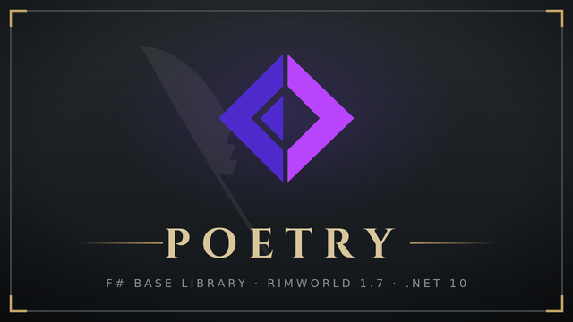

# FSharp.Core.Dll



A F# Core inspired by [alattalatta/Monoworld](https://github.com/alattalatta/Monoworld/blob/main/Poet).

## Dev

Debug:

```bash
dotnet build
```

Release:

```bash
dotnet publish
```

Pack:

```bash
dotnet publish
dotnet fsi pack.fsx
```

## Items

> [!NOTE]
> Poetry .dll will have some util code.

- FSharp.Core.dll
- Poetry.dll

## Credits

- **Poet** [alattalatta/Monoworld](https://github.com/alattalatta/Monoworld/blob/main/Poet)
